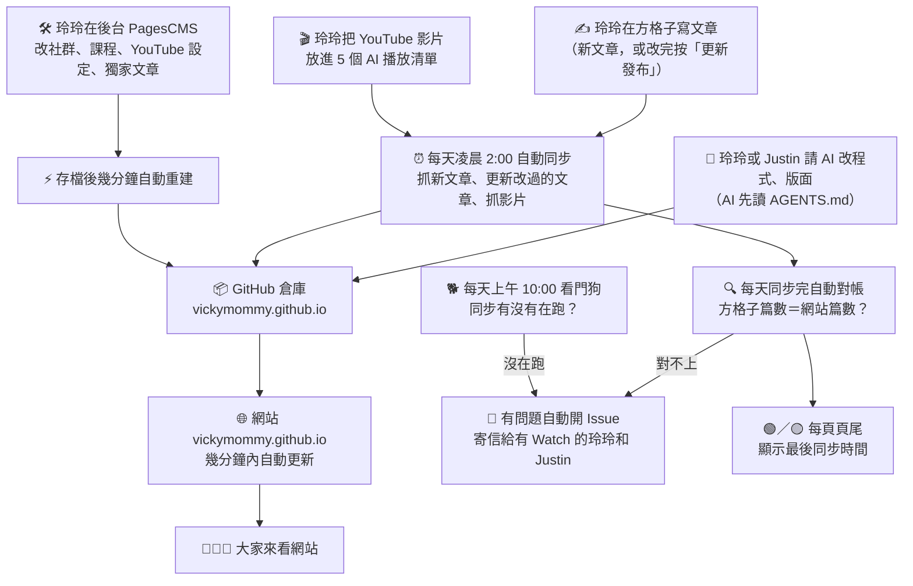

# Vicky Mommy 網站｜維護手冊（白話版）

> 給玲玲和 Justin 看的。想做什麼就查第二節「我想做 X」。
> 要請 AI 改網站：把 `docs/給AI的交接提示詞.md` 整段貼給它。
> 技術細節（給 AI 看的）在 repo 根目錄的 `AGENTS.md`；誰改過什麼在 `docs/維護紀錄.md`。
> 最後更新：2026-11-18 晚（加「一張圖看懂」流程圖）；2026-11-18 晚（方格子改內文網站會自動跟著改、文章內影片改成連結）；2026-11-18（取代原本的 manual.html 手冊）

---

## 〇、一張圖看懂網站怎麼運作

> 在 GitHub 上打開這份手冊，下面會自動畫成流程圖。網站改了運作方式時，這張圖要一起改。

**記住三件事就好：**
1. **文章、影片照常在方格子、YouTube 發**，網站隔天自動有，不用進後台。
2. **網站壞了你會收到信**（前提是有 Watch），頁尾燈號是 🟢 就代表一切正常。
3. **要改網站本身**（版面、新功能），請 AI 幫忙或找 Justin，改完會記在 `docs/維護紀錄.md`。

---

## 一、先認識這幾個地方

| 地方 | 網址 | 用來做什麼 |
|---|---|---|
| 網站（大家看到的） | https://vickymommy.github.io/ | |
| 後台 PagesCMS | https://app.pagescms.org/ | 改文章、社群、課程、YouTube 設定（不用碰程式） |
| GitHub（網站的家） | https://github.com/vickymommy/vickymommy.github.io | 放所有檔案；手動同步、看 Issue 通知都在這裡 |
| 方格子 | https://vocus.cc/ | 玲玲平常寫文章的地方，網站每天自動抓過來 |

**帳號**：玲玲 `vickytsai927`、Justin `justin-n8n`，兩人都是網站的維護者，都能改（權限見第六節）。組織名稱 `vickymommy`。

**進後台**：打開 https://app.pagescms.org/ → 「Sign in with GitHub」→ 用自己的 GitHub 帳號登入 → 點「vickymommy / vickymommy.github.io」。

---

## 二、我想做 X → 去哪裡

| 我想… | 怎麼做 | 多久看得到 |
|---|---|---|
| 在方格子發了新文章，網站也要有 | **什麼都不用做**，每天凌晨 2 點自動抓 | 隔天早上 |
| 方格子新文章想現在就上網站 | GitHub → 上方「Actions」→ 左邊「每日自動同步」→ 右邊「Run workflow」→ 綠色「Run workflow」 | 3～10 分鐘 |
| 改了方格子某篇文章的內文 | 在方格子改完按「更新發布」就好，網站會自動跟著改內文（標題、分類、摘要、封面維持網站原本的，要改請在後台改） | 隔天早上 |
| 發一篇只在網站有的文章 | 後台「心情日誌（文章）」→「Add an entry」→ 填好按「Save」；「原文連結（方格子）」留空 | 1～2 分鐘 |
| 改某篇文章的分類、摘要、標籤 | 後台「心情日誌（文章）」→ 找到那篇 →「Edit」→ 改完「Save」 | 1～2 分鐘 |
| 新 YouTube 影片要上網站 | 在 YouTube 把影片放進網站用的那 5 個播放清單之一 | 隔天 |
| 換播放清單、改影片頁介紹 | 後台「YouTube 影片（設定）」；「英文代號」不要改 | 幾分鐘 |
| 改課程資訊、報名連結 | 後台「課程（設定）」 | 1～2 分鐘 |
| 改 LINE／FB／IG 連結、社群介紹 | 後台「社群交流圈（設定）」 | 1～2 分鐘 |
| 改版面、加新頁面、改功能 | 請 AI 幫忙（貼交接提示詞），或請 Justin | |

**文章分類**（只能選一個）：AI 學習｜AI 活動 & 聚會｜AI 應用交流分享會｜媽媽自我成長｜育兒知識｜親子旅遊｜玩具手作 DIY

**常見英文按鈕**：Save＝存檔、Edit＝編輯、Delete＝刪除、Add an entry＝新增一筆、Add item＝清單裡加一項、Cancel＝取消。後台左下的「Actions」是 PagesCMS 自己的功能，空的是正常的，不用管。

**圖片**：jpg、png、webp、gif，不超過 5MB，檔名用英文或數字；封面建議 16:9、寬 800px 以上。

---

## 三、網站自己會檢查自己（你只要看信）

網站每天會自動做三道檢查，有問題會在 GitHub 開一張「Issue」（問題單），有 Watch 這個 repo 的人會收到 email。

**頁尾燈號**：每一頁最下面有「文章最後同步 11/18 02:00 🟢」。
- 🟢 正常：2 天內有同步，而且方格子和網站的文章數對得上。
- 🟡 有問題：滑鼠移上去看原因。通常隔天會自己好；連續兩天都是 🟡，看下面的 Issue 信。

### 收到 Issue 信怎麼辦

| 信的標題 | 意思 | 怎麼辦 |
|---|---|---|
| ⚠️ 方格子與網站文章對不上 | 有文章沒同步過來、或網站多了方格子已經沒有的文章 | 信裡會列出是哪幾篇。**缺文章**：先按第二節「現在就上網站」手動同步一次。**多文章**：如果是你把那篇在方格子設成不公開，就不用管。還是不對 → 請 Justin 或 AI 看 |
| 🐕 看門狗：每日同步可能沒有在跑 | 超過 30 小時沒同步，或設定檔壞了 | 轉給 Justin，或把這張 Issue 的網址貼給 AI 請它查 |
| 📝 方格子改過的文章，網站沒自動更新 | 你在方格子改了某篇，但網站上那篇之前也在後台改過，為了不蓋掉先沒動 | 要保留網站版本：關掉 Issue；要換成方格子版本：請 AI 或 Justin 幫忙（信裡有寫哪幾篇） |
| 其他「…失敗」 | 某次自動執行失敗 | 偶爾一次通常是方格子或 GitHub 暫時連不上，隔天會好；連續失敗再找人看 |

同一件事每天會補在同一張 Issue 下面，不會一天一封新的。修好後在 Issue 頁面按「Close issue」。

**一定要 Watch**：GitHub 網站 repo 右上角「Watch」→ 選「All Activity」（或「Custom」勾 Issues）。沒 Watch 就收不到信。

---

## 四、兩個人一起維護的規矩

- 玲玲可以自己改、請 ChatGPT 改，也可以請 Justin 幫忙；Justin 也可能直接幫忙改。
- **誰改了什麼都記在 `docs/維護紀錄.md`**（AI 會自動記；自己在後台改文章、課程這種日常內容不用記）。
- 想請 Justin 幫忙：直接跟他說要改什麼；或在 GitHub 開一張 Issue 寫清楚，指派（Assignees）給 `justin-n8n`。
- 不要兩個人同時改同一個地方；改之前先看一下維護紀錄最近有沒有人在動。

---

## 五、常見問題

**Q：存完一直沒看到網站更新？**
等 5 分鐘還沒變，到 GitHub「Actions」看有沒有紅色 ❌，截圖給 Justin 或貼給 AI。

**Q：方格子發文隔天網站還沒有？**
先確認方格子那篇是「公開發布」（不是草稿）。是公開的還沒出現，看頁尾燈號和 Issue 信。

**Q：不小心在後台刪了文章？**
救得回來：GitHub 保留每一次修改的歷史。告訴 Justin 或 AI 是哪一篇。

**Q：可以先存草稿嗎？**
後台按 Save 就直接上線，沒有草稿。還沒寫好就先別按 Save，或先寫在方格子草稿。

**Q：可以在後台改方格子同步來的文章內文嗎？**
可以改，網站會顯示你改的版本。但方格子那邊不會跟著變；之後你在方格子又改這篇時，網站**不會自動蓋掉**你在後台改的，會寄一封「📝 方格子改過的文章，網站沒自動更新」的 Issue 信問你要用哪一版。建議內文只在方格子改。

**Q：網站上的電話、地址、密碼可以放進 GitHub 嗎？**
不行。這個 repo 是公開的，放進去全世界都看得到。

---

## 六、帳號安全

- 兩位維護者的 GitHub 都已開兩步驟驗證（2FA），組織也規定成員一定要開（2026-11-18）。
- 換手機前，先確認 GitHub 的備用碼（Recovery codes）還找得到。
- 權限（2026-11-18 查）：Justin 是組織 Owner；玲玲已被邀請成為組織 Owner（GitHub 會寄邀請信，按「Join vickymommy」接受），接受前是 repo 的協作者（可以改內容和程式，但不能改設定）。兩個 Owner 權限一樣，一個帳號出問題另一個還能救。
